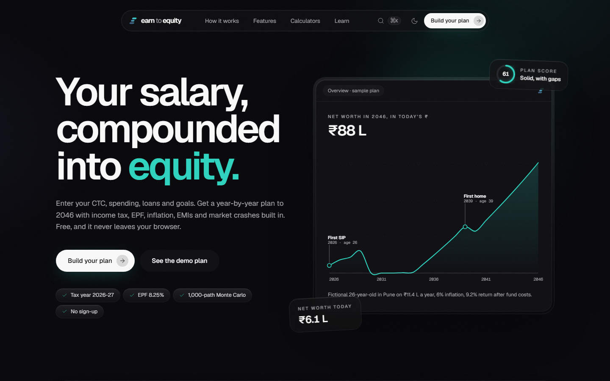
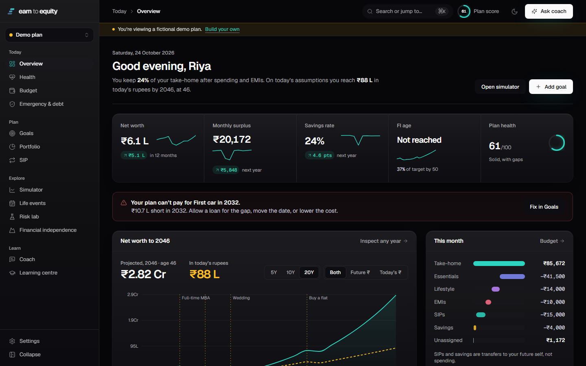
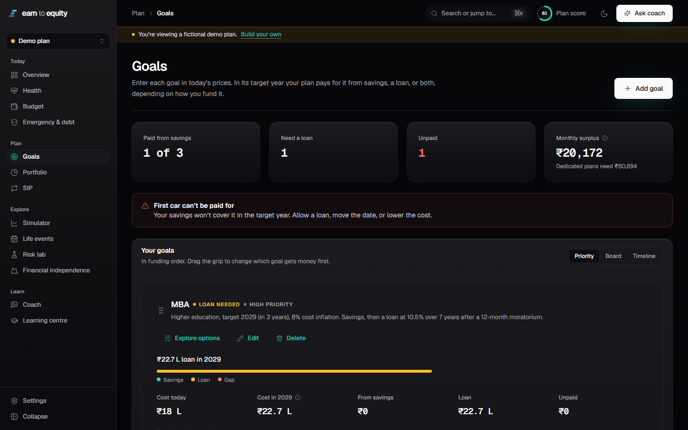
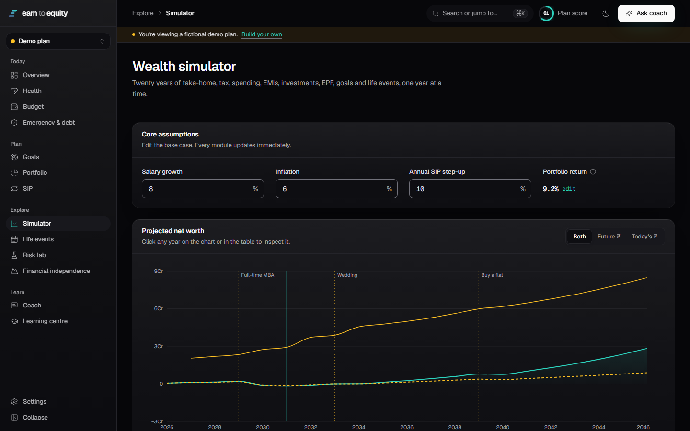
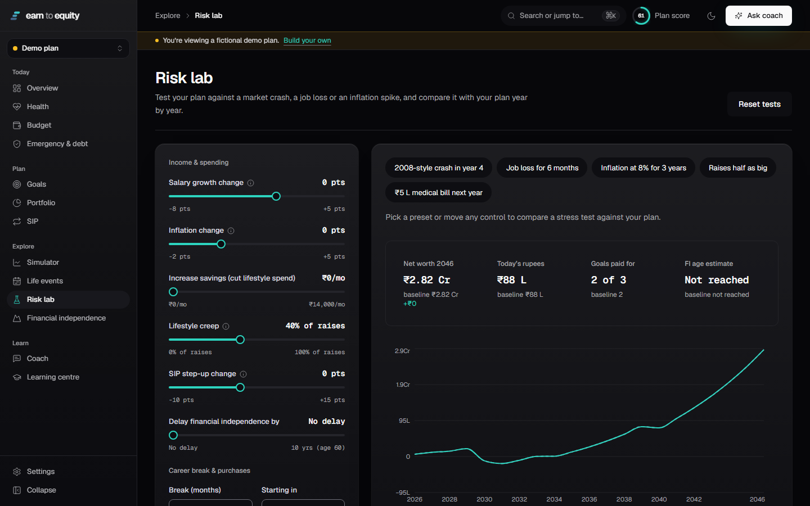

# Earn to Equity

A 20-year financial plan for salaried professionals in India. You enter your CTC, spending, loans, savings and goals, and the planner works out your take-home pay under the 2026-27 tax rules, then projects every year that follows: tax, EPF, EMIs, SIPs, inflation, the goals you can pay for, the ones you can't, and what a market crash or a career break would do to all of it.

It runs entirely in your browser. There is no sign-up and no server holding your data.

**[Open the live site →](https://33avash.github.io/earn-to-equity/)**



---

## Contents

- [Why we built it](#why-we-built-it)
- [Using it](#using-it)
- [What the planner does](#what-the-planner-does)
- [How the numbers are worked out](#how-the-numbers-are-worked-out)
- [Default assumptions](#default-assumptions)
- [What it does not model](#what-it-does-not-model)
- [Your data](#your-data)
- [Running it locally](#running-it-locally)
- [Project layout](#project-layout)
- [Tests](#tests)
- [Deployment](#deployment)
- [Team](#team)
- [License](#license)
- [Disclaimer](#disclaimer)

---

## Why we built it

Most people in India get their first salary with very little guidance on what to do with it. Online SIP calculators answer one question (what does ₹10,000 a month become?) and ignore everything around it: income tax that rises as your CTC crosses slabs, EPF, the loan you will take for an MBA, the flat you want in your thirties, the year you take off work.

Earn to Equity puts all of that into one model. Every screen reads from the same profile and the same year-by-year projection, so changing your rent on the Budget page moves your FI age on the next screen.

## Using it

There are two ways in:

- **See the demo plan.** Loads a fictional profile (Riya, 26, a software analyst in Pune on ₹11.4 L CTC) so you can look around without typing anything. A banner across the top reminds you it is demo data.
- **Build your plan.** An eight-step setup: about you, income and career, monthly cash flow, what you own and owe, protection (emergency fund and insurance), goals, investment mix, and a review. Every step says why it asks what it asks. Optional fields can be skipped, and anything can be changed later.

If you already have a plan and open the demo, your own plan is set aside, not overwritten. The plan switcher at the top of the sidebar brings it back.

Press **⌘K** (or **Ctrl+K**) anywhere to search pages, lessons, glossary terms, your goals and your own figures, or to run actions such as adding a goal or starting a stress test.

<table>
  <tr>
    <td></td>
    <td></td>
  </tr>
  <tr>
    <td></td>
    <td></td>
  </tr>
</table>

## What the planner does

The planner lives at `/app` and has thirteen modules in four groups.

### Today

**Overview.** Net worth, monthly surplus, savings rate, FI age and plan health, each with a small trend line and the change expected over the next year. Below that: the 20-year net-worth chart in both future and today's rupees with your life events marked on it, a breakdown of this month's take-home (essentials, lifestyle, EMIs, SIPs, savings, and whatever is left unassigned), and a short list of next steps you can tick off. If a goal can't be paid for, a warning at the top says which one, by how much, and links to the fix.

**Financial health.** A score from 0 to 100 built from six parts. The rule for each part is shown on the page:

| Part | Weight | How it is scored |
|---|---|---|
| Emergency preparedness | 20 | Liquid savings ÷ your emergency target. Full marks at or above target. |
| Savings rate | 20 | Income left after expenses and repayments. 0 at 0%, full marks at 30%. |
| Debt burden | 15 | EMIs as a share of income. Full marks at 10% or less, 0 at 50%. |
| Investment consistency | 15 | Monthly investing as a share of income. 0 at 0%, full marks at 20%. |
| Goal readiness | 15 | Average share of each goal's required monthly contribution your surplus covers. 50 if you have no goals. |
| Protection | 15 | Half for health cover at or above the benchmark for your city and household, half for term cover of 10× annual income (given automatically if nobody depends on your income). |

The score is an educational measure. It is not a credit score.

**Budget.** CTC to take-home under both tax regimes side by side, with the cheaper one used by default. Monthly essentials, lifestyle spending, EMIs, SIPs and savings as editable line items, plus an optional 50/30/20 comparison.

**Emergency & debt.** Your emergency reserve target (3 to 12 months of essentials plus EMIs, the bills that keep coming if your income stops), how many months you hold now and how long it takes to close the gap. For loans, a month-by-month payoff comparison of avalanche (highest rate first) and snowball (smallest balance first) with any extra monthly amount you choose, including total interest and the month each loan is cleared.

### Plan

**Goals.** Each goal is entered in today's prices and inflated to its target year (education costs use a separate, higher inflation rate). Each goal is funded in one of three ways:

- **Savings:** paid from your liquid savings in the target year. If there isn't enough, the goal is left unpaid and reported as a shortfall.
- **Loan:** paid by a new loan taken that year.
- **Savings, then a loan:** savings first and a loan for the rest. This is the default for education and cars.

Goals receive money in priority order. You can drag them to reorder, and the priority labels follow the position. Each goal shows its cost today, its cost in the target year, and how much comes from savings, from a loan, or is still unpaid. There are list, board and timeline views.

**Portfolio.** A target mix across seven asset classes (Indian equity, international equity, debt, government schemes such as PPF, gold, cash, other), with four example mixes from conservative to aggressive. It shows the expected return after fund costs, an estimated volatility, how far your current holdings have drifted from the target, and how to rebalance using new SIP money only (no selling).

**SIP.** A monthly SIP projection with an optional lump sum, a yearly step-up, a choice of investing at the start or end of each month, and a comparison of a flat SIP against a stepped-up one. Results are shown before and after long-term capital-gains tax.

### Explore

**Wealth simulator.** The full year-by-year projection. Edit salary growth, inflation, SIP step-up and portfolio return and every module updates. Click any year on the chart or the table to open a year inspector showing that year's income, tax, spending, EMIs, investments, EPF, goals paid and events. It also has three scenarios (conservative, base, high growth) with a breakdown of how much of the difference each assumption causes, a tornado chart ranking which assumption moves the outcome most, and a CSV export.

**Life events.** Promotions, career breaks, a wedding, a home purchase or any one-off cost, each with its before-and-after effect on net worth. Buying a home includes the state's stamp duty and registration, GST on an under-construction flat, interiors, and a check against the 50% limit lenders put on EMIs as a share of take-home.

**Risk lab.** Stress tests run through the same engine as your plan, shown against your baseline year by year. One-click presets: a 2008-style crash in year 4, a six-month job loss, 8% inflation for three years, raises half as big, and a ₹5 L medical bill next year. You can also move each control yourself (salary growth, inflation, extra savings, lifestyle creep, SIP step-up, a delayed FI date, career breaks and purchases). A Monte Carlo section runs 1,000 market paths and shows the 10th, 50th and 90th percentile of net worth each year, the probability that each goal gets paid, and the probability of reaching your FI target. It includes your income, spending and event tests, but not the single market decline, which is shown separately.

**Financial independence.** Your FI target corpus, the corpus you are projected to have, the gap, your estimated FI age, and the extra monthly SIP needed to reach the target by the age you chose.

### Learn

**Coach.** Ask questions about your plan in plain language ("Can I afford a flat in 2035?", "Why is my savings rate low?"). Answers quote figures from your own projection. See [the coach](#the-coach) for how it works.

**Learning centre.** Eleven lessons of 4 to 8 minutes each, with a worked example from the planner's engine, key points and a three-question check: budgeting, compounding, inflation, SIPs and step-ups, asset allocation, diversification, volatility and drawdowns, good and costly debt, tax awareness, EPF/PPF/NPS, and financial independence. A separate tax reference lists every dated rate with its official source.

### Public pages

The landing page has six one-minute interactive lessons, a live SIP calculator, three what-if scenarios and the real planner panels running on the demo plan. There are also How it works, Features, Calculators (SIP, loan EMI, inflation), Learn, About and Legal pages.

## How the numbers are worked out

All of the maths is in `src/finance/`, written as plain TypeScript with no React, so it can be tested on its own. The core is `simulate.ts`, one projection engine that every screen calls.

### Timing

- The plan starts on 1 January of the current year. A 20-year plan has 21 points: today, then 1 January of each following year.
- Your age is your age on 1 January of each year.
- The engine steps month by month. Within a month, loan interest accrues, then repayments are made, then the surplus is invested or saved.
- Salary growth, inflation and SIP step-ups apply at the start of each year from the second year.
- Goals and life events dated in a year happen at the start of that year.

### Rates

- Investment returns are effective annual rates, compounded monthly as `(1 + r)^(1/12) − 1`, so twelve months reproduce the stated yearly return exactly.
- Loan rates are APRs, the Indian EMI convention: the monthly rate is APR ÷ 12, and EMIs use the standard reducing-balance formula.
- Returns are always after fund costs (expense ratios).
- "Today's rupees" means a future amount divided by cumulative inflation, so you can compare it with prices now.

### Salary and tax

When you enter a CTC, take-home is recalculated from it every year. CTC is treated as gross salary plus the employer's PF contribution; gratuity and variable pay are left out. Each year the engine deducts:

- **EPF:** 12% of basic pay from you and 12% from your employer. The part of your employer's share that goes to the pension scheme (8.33% of up to ₹15,000 a month) is not counted as savings.
- **Professional tax** for your state (₹2,500 a year in Maharashtra, Karnataka and Tamil Nadu; ₹2,400 in Telangana, West Bengal and Gujarat; nil in Delhi, Haryana and Uttar Pradesh).
- **Income tax** under both regimes, using whichever is cheaper unless you pick one. Slab tax, then the rebate with marginal relief, then surcharge with marginal relief, then 4% cess.
  - New regime: nil up to ₹4 L, then 5% for each ₹4 L band up to 30% above ₹24 L, a ₹75,000 standard deduction and a rebate of up to ₹60,000 on income up to ₹12 L. A salary up to about ₹12.75 L pays no tax.
  - Old regime: nil up to ₹2.5 L, 5% to ₹5 L, 20% to ₹10 L, 30% above, a ₹50,000 standard deduction, 80C up to ₹1.5 L (your PF counts towards it), 80D up to ₹25,000, and an HRA exemption you enter yourself.

Because raises apply to CTC, take-home grows more slowly than CTC as you move into higher slabs. In a year with a career break, tax is worked out on the months you were paid.

If you enter a take-home figure instead of a CTC, it simply grows at your salary-growth rate.

**Lifestyle creep.** By default, 40% of every above-inflation rise in take-home is added to lifestyle spending for good. You can change this.

### Investments and capital gains

- Selling investments realises gains in proportion to how much of the portfolio is gain rather than cost. Holdings are assumed to be long-term and held in your target mix.
- Equity gains above ₹1.25 L a year are taxed at 12.5%. Gold, international and other funds at 12.5%. Debt funds and cash at your slab rate. Government schemes such as PPF are tax-free.
- When tax is due on a sale, a little more is sold to pay it.

### What counts as spending

- Moving money into savings or investments is a transfer, not an expense.
- Repaying loan principal moves money from cash to a smaller loan. Only interest, taxes and costs reduce net worth.
- Buying a home turns the down payment into a property asset and adds a loan. Stamp duty, registration, GST and interiors are costs. Maintenance and property tax become recurring expenses.
- Money set aside for a goal is assumed to already sit inside your cash or investments, so it isn't counted twice.

### Goals and shortfalls

- A goal is paid once, in its target year, according to its funding choice.
- A savings-only goal that can't be afforded is left unpaid and shown as a shortfall. It is not quietly paid with money that doesn't exist.
- Retirement and FI goals are targets for your corpus and are never withdrawn.
- If a goal goes unpaid, life events linked to it (for example, the career break for an MBA) are dropped and the projection is rerun without them, unless you choose to keep them.
- For goals paid partly by a loan, enough savings are held back to cover rent and EMIs through any linked career break, so the loan pays the fees and your savings pay the bills.

### When money runs short

If spending is more than income in a month, the engine uses cash above your emergency reserve first, then investments, then the reserve itself. Anything still unpaid becomes short-term borrowing charged at 14% a year. While that borrowing is outstanding, surpluses repay it before any SIP is made. Cash above your emergency target is invested at the end of each year (you can turn this off).

### Financial independence

FI target = (yearly living costs + extra healthcare after FI) ÷ the withdrawal rate, plus any debt still owed. Healthcare grows at its own inflation rate. Financial assets count after the tax that would be due if they were sold, and include EPF (flagged, because it can't be withdrawn before 58). Your home is not counted.

### Scenarios and stress tests

- The conservative and high-growth scenarios shift your own assumptions: salary growth −3 / +3 points, returns −2 / +1.5 points, inflation +1 / −0.5 points, SIP step-up −5 / +5 points. You can edit these.
- The attribution changes one assumption at a time to see how much of the difference each one causes. Because assumptions interact, the parts don't always add up to the total, and the remainder is shown separately.
- The Monte Carlo draws each year's return independently, after fund costs, and runs every path through the same engine. Two return models are available: fat-tailed returns (Student-t with 5 degrees of freedom, scaled to your assumed return and volatility), or actual Nifty 50 total-return years from 2005 to 2025 drawn at random for the Indian-equity share. The random generator is seeded, so the same inputs always give the same result.
- Portfolio volatility assumes a constant 0.3 correlation between every pair of asset classes. That is good enough to compare mixes, but it is not a forecast of risk.

### The coach

By default the coach is rule-based. It reads the figures your plan has already calculated and recognises six kinds of question: whether you can afford a home (and when), why a goal is behind, what a different salary growth rate would do, what a market fall in a given year would do, how much more to save, and an explanation of your projection. Anything else gets a summary of your key figures and examples of what to ask. It needs no network connection and is what the live site uses.

You can switch it to Google's Gemini on your own machine (see [Running it locally](#running-it-locally)). In that mode the browser sends your question and a compact summary of figures the engine has already calculated (no name) to a small server-side handler, which calls Gemini. The model is told to use only those figures, quote them exactly, state the assumptions behind them, say what is missing if it can't answer, and not recommend specific funds or insurers. The API key stays on the server and is never bundled into the site. Requests over 64 KB are rejected. If Gemini isn't configured or fails, the rule-based coach answers instead and the page says so.

## Default assumptions

Every dated rule and rate is kept in one file, `src/finance/assumptions.ts`, with the date it was checked and the official page it was checked against. The Settings page lists them all with their sources. Last full review: 18 October 2026.

| Assumption | Default |
|---|---|
| Inflation | 6% a year |
| Education cost inflation | 9% a year |
| Healthcare inflation after FI | 10% a year |
| EPF interest | 8.25% a year |
| SIP step-up | 10% a year |
| Lifestyle creep | 40% of real raises |
| Property price growth | 5% a year |
| Home-loan rate | 8% |
| Education loan | 10.5% over 7 years, 12-month moratorium |
| Car loan | 9.5% over 5 years |
| Lender EMI limit | 50% of take-home |
| Safe withdrawal rate | 3.5% |
| Short-term borrowing rate | 14% |
| Plan length | 20 years |

| Asset class | Return before costs | Fund cost | Volatility |
|---|---|---|---|
| Indian equity | 11% | 0.2% | 18% |
| International equity | 9% | 0.5% | 16% |
| Debt | 7% | 0.3% | 4% |
| Government schemes (PPF etc.) | 7.1% | 0% | 1% |
| Gold | 7.5% | 0.2% | 15% |
| Cash | 3.5% | 0.2% | 0.5% |
| Other | 8% | 0.8% | 10% |

These are long-run planning assumptions, not forecasts, and they can all be changed in Settings, the Simulator or the Portfolio page.

## What it does not model

We would rather list these than have them found later:

- **Tax.** Exit loads, surcharge on capital gains, and deductions other than 80C, 80D and HRA are not modelled. HRA exemption is a figure you enter; it isn't calculated from your rent. Tax rules are for a resident individual under 60.
- **Salary.** Gratuity, bonuses and variable pay are left out of CTC.
- **Investments.** Holdings are assumed to be long-term and in your target mix, so short-term capital-gains tax on recent purchases isn't applied. Volatility uses a single fixed correlation. Each Monte Carlo year is drawn independently, so it doesn't capture the way bad years tend to cluster.
- **Lock-ins.** EPF counts towards FI but is flagged as locked until 58. Lock-in periods on PPF and NPS are not enforced in the projection.
- **Insurance.** The plan checks your health and term cover against benchmarks. Premiums are whatever you enter as expenses, and claims being paid out are not modelled.
- **Data.** There is no import yet. The JSON export is a copy for your records, but you can't load it back into the app.
- **Coach.** The live site always uses the rule-based coach. Gemini needs the dev or preview server described below.

## Your data

- Your profile, goals, events, assumptions and settings are saved in your browser's local storage on this device, under the key `e2e:v1` (the theme choice is under `e2e:theme`). Nothing is sent to an Earn to Equity server, because there isn't one.
- Local storage isn't encrypted and doesn't sync between devices or browsers. Clearing site data deletes your plan.
- The app never asks for bank logins, card numbers, PAN, Aadhaar or other identity documents.
- From Settings you can download a summary (`.txt`), the full data (`.json`) or the year-by-year projection (`.csv`), reset to the demo plan, or erase everything.
- The only time anything leaves your browser is if you run the Gemini coach yourself, as described above.

## Running it locally

You'll need Node.js 22.19 or newer.

```bash
git clone https://github.com/33avash/earn-to-equity.git
cd earn-to-equity
npm install
npm run dev
```

Then open http://localhost:5173.

| Command | What it does |
|---|---|
| `npm run dev` | Start the development server |
| `npm test` | Run the full test suite |
| `npm run typecheck` | Type-check the project |
| `npm run build` | Type-check and build for production into `dist/` |
| `npm run preview` | Serve the production build locally |

### Optional: the Gemini coach

```bash
cp .env.example .env
```

Set `GEMINI_API_KEY` in `.env` (and optionally `GEMINI_MODEL`). The key is read only by `server/coach.ts`, which the dev and preview servers mount at `/api/coach`. Don't prefix it with `VITE_`, or Vite would put it into the browser bundle. Without a key, the coach stays rule-based.

## Project layout

```
src/
  finance/      The calculation engine: tax, salary, simulation, goals, debt, FI, Monte Carlo.
                Plain TypeScript with no React. Every dated rate lives in assumptions.ts.
  state/        Zustand store (saved to local storage), the demo profile, and selectors that
                turn a profile into a computed plan.
  types/        The FinancialProfile model and simulation types.
  components/   UI primitives, charts, layout (public site and planner shell) and motion helpers.
  features/     Larger pieces: onboarding, editors, landing-page sections, lessons.
  pages/        The public pages and the thirteen planner screens.
  services/     The coach (rule-based and Gemini client) and data export.
  theme/        Light, dark and system theme handling.
server/         The optional Gemini handler.
tests/          Engine, accessibility and copy tests.
docs/           Screenshots used in this README.
```

Built with React 18, TypeScript, Vite, Tailwind CSS, Radix UI, Recharts, Zustand, Motion, cmdk and Lucide icons. Tested with Vitest, Testing Library and axe.

## Tests

`npm test` runs 246 tests across eight files:

- **Engine (`tests/finance`).** Formula checks for tax, EMIs, SIPs and inflation; invariants that must always hold, such as net worth equalling assets minus liabilities in every year and a zero-return run giving back exactly what was put in; goal funding, shortfalls and linked events; and a saved snapshot of the demo plan's 21-point projection, so any change to the numbers is caught and has to be reviewed on purpose.
- **Accessibility (`tests/a11y`).** Every public page and planner screen is rendered and checked with axe in both light and dark themes, and colour contrast is computed from the theme tokens (at least 4.5:1 for text and 3:1 for controls).
- **Copy (`tests/copy`).** Fails the build if retired taglines or banned words come back into the interface.

## Deployment

Every push to `main` runs the tests, builds the site and publishes it to GitHub Pages through `.github/workflows/deploy.yml`. The build sets `BASE_PATH=/earn-to-equity/` so assets and routes work under the repository path, and copies `index.html` to `404.html` so links straight to a planner page (such as `/app/goals`) still load. GitHub Pages only serves static files, so the live site always uses the rule-based coach.

## Team

Atulya Singh · Avash Srivastava · Aayushi Paul · Agustyae Gupta

## License

Released under the [MIT License](LICENSE). You can use, change and share the code, including commercially, as long as the copyright notice stays with it. The licence covers the code only; it doesn't make the projections financial advice (see below).

## Disclaimer

Earn to Equity is an educational project. It is not a SEBI-registered investment adviser, research analyst, stockbroker, insurance intermediary or tax practitioner, and it does not give personal investment, tax, legal or insurance advice. Every projection is an estimate built from assumptions you can change, and real outcomes will differ, sometimes by a lot. Example portfolios are there to show how allocations work, not to recommend anything. Tax figures are dated reference material; check them against official sources or with a qualified professional before acting on them.
